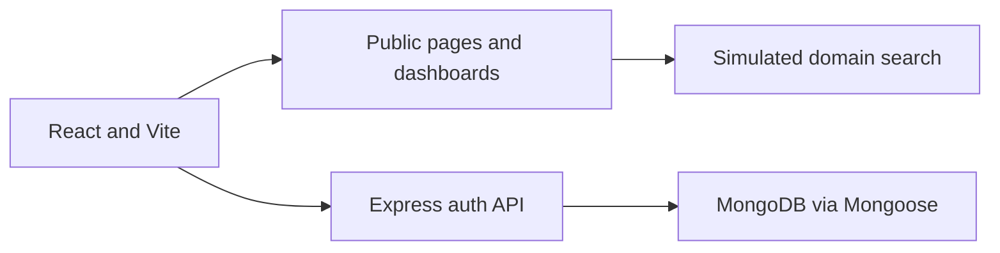

# QDomains

A domain-marketplace **prototype** exploring domain search, pricing, account interfaces, and role-specific dashboards.

[Live prototype](https://q-domains-fko5.vercel.app/) · [Portfolio](https://mohammed-zakee.github.io/Portfolio/)

## What the project demonstrates

- React 19 and Vite frontend with React Router.
- Public domain, hosting, pricing, and information pages.
- Client, service, and administrator dashboard interfaces.
- An Express/Mongoose authentication API with password hashing and JWT-based sessions.
- A Three.js globe component in the frontend.

## Prototype boundaries

Domain availability in `src/pages/DomainsPage.jsx` is generated with a delayed random result. It is **not** queried from a domain registrar. The displayed pricing and registration actions do not establish a completed registrar purchase or payment integration.

The current public prototype is available at https://q-domains-fko5.vercel.app/. Its landing interface was visually reviewed; domain registration, payments, and end-to-end backend operation are not established by that check.

## Architecture



## Local setup

Use a Node.js version compatible with Vite 8 and a development MongoDB database.

```sh
npm install
npm run dev
```

The frontend runs on Vite's displayed local URL, normally `http://localhost:5173`.

To explore the authentication backend in a separate terminal:

```sh
cd server
npm install
node server.js
```

Configure `MONGODB_URI`, `JWT_SECRET`, and optionally `PORT` in a local `server/.env` using your own development values. The API defaults to port 5000. Do not copy shared demo accounts or existing connection values into a public deployment.

## Useful commands

| Command | Purpose |
|---|---|
| `npm run dev` | Start the frontend |
| `npm run build` | Build the frontend |
| `npm run preview` | Preview a built frontend |
| `npm run lint` | Run the configured frontend lint checks |

These commands are defined in `package.json`; this documentation update does not claim they were all executed.

## Source guide

| Path | Purpose |
|---|---|
| `src/App.jsx` | Application routes |
| `src/pages/DomainsPage.jsx` | Search prototype and pricing table |
| `src/pages/` | Public and dashboard interfaces |
| `src/context/AuthContext.jsx` | Frontend authentication state |
| `server/server.js` | API startup and database connection |
| `server/routes/auth.js` | Registration, login, and demo setup routes |

## Trade-offs and next steps

The prototype prioritizes demonstrating navigation and interface flows. Before treating it as a real service, replace simulated availability with a registrar integration, complete the cart/payment lifecycle, replace demo role assignment and seeding with server-enforced authorization, remove shared demo credentials, and add validation and integration tests.

No live registrations, paying customers, security certification, or business-impact metric is claimed. Individual module ownership and team size are not inferred from repository ownership.
